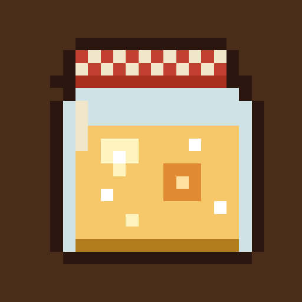
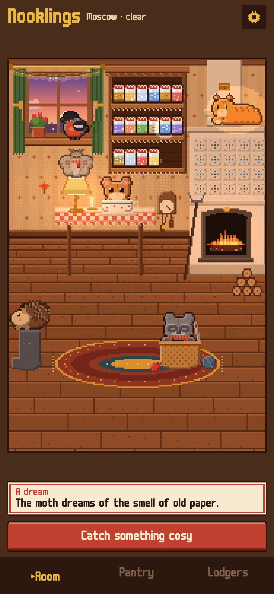
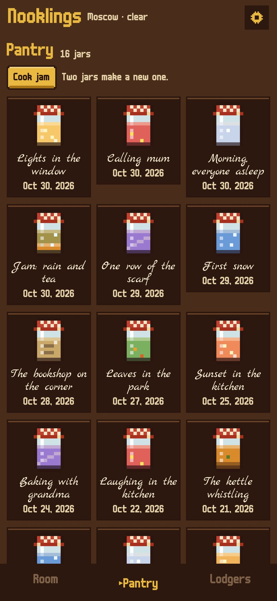
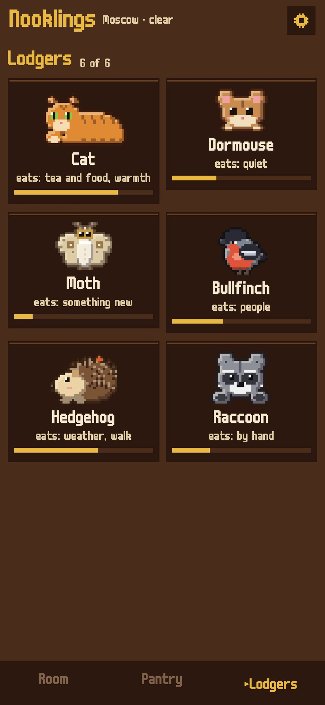
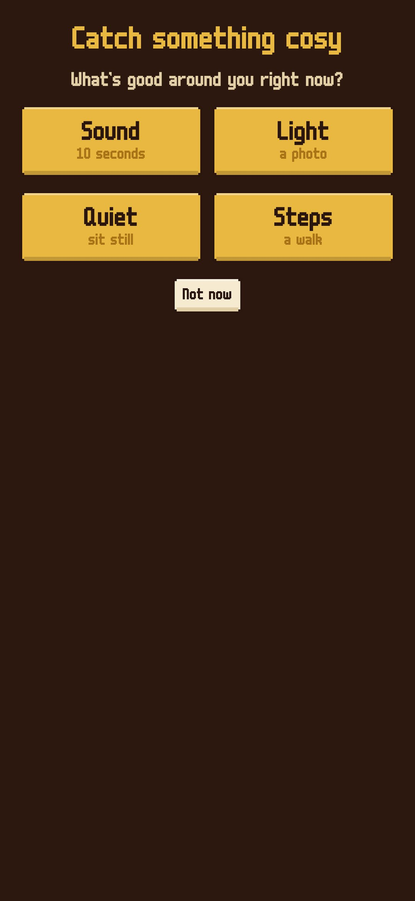

<div align="center">



# Nooklings

### Catch the cosy moments of your day into jars, and the little lodgers of your room will eat them

*Rain on the umbrella, the kettle whistling, a lamp in the evening, a quiet minute: you don't plan cosiness from a list, you notice it. Catch it with the phone and it's rolled into a glowing jar on the pantry shelf. Six lodgers live in a pixel room and each eats its own kind of cosiness. On a hard day, open a jar and listen. Free, no ads, no account.*

[](https://github.com/bigdevwhale/nooklings/actions/workflows/android.yml)


[](LICENSE)

**English** · [Русский](README.ru.md)

   

</div>

---

## How it works

1. **Catch.** One button, four ways: **sound** (ten seconds from the microphone), **light** (a photo through the phone's own camera; its colour fills the jar), **quiet** (three minutes in which the room really is quiet; only the loudness is measured, nothing recorded) and **steps** (the step counter; walks can be caught on their own).
2. **Name it.** One tap: weather, walk, tea and food, warmth, something new, people, by hand. The jar gets a handwritten label, the date, the town and the weather it was caught in.
3. **The lodgers eat.** The cat eats warmth and tea, the dormouse quiet, the moth (in glasses) something new, the bullfinch voices, the hedgehog weather and walks, the raccoon things made by hand. Only the cat and the dormouse live here at first; the others knock at the window when the first jar of their kind appears.
4. **Nobody dies.** A hungry lodger sleeps pale in a knitted scarf and wakes with the next jar. Full ones glow; in the evening, when everyone is full, they pile up by the stove.
5. **Dreams.** Now and then a lodger dreams a riddle ("The moth dreams of the smell of old paper"). Bring that kind of cosiness and the dream comes true, with a gift that stays in the room: a rug, a candle, a postcard, rowan berries, a maple leaf, a string of lights.
6. **Open a jar.** It plays what it caught (jars without a recording sound like their kind: rain, a kettle, a crackling stove, pages, voices, knitting needles, steps), the stove flares and everyone gathers to listen.
7. **Jam.** Two jars cook into a new one that feeds both lodgers.

The window shows the real time of day and the real weather of your town (Open-Meteo, with MET Norway as a fallback). Snow, storms and night make rare jars.

## Privacy

Everything stays on the phone: sounds and photos live in the app's own folder and never leave it. The only network requests are the weather and the town search, and they carry only coordinates or the town's name.

## Building

```
./gradlew assembleDebug                      # debug build (app.nooklings.dev)
./gradlew assembleDebug -Pdemo               # a pantry full of jars, every lodger home
./gradlew testDebugUnitTest                  # the household logic, the step counter, the sounds
./gradlew testDebugUnitTest -Prender --tests '*RenderScreens*' && python tools/shots.py   # screenshots
python tools/res.py                          # strings, English and Russian, from one table
python tools/icon.py                         # the launcher icon
```

Kotlin, Jetpack Compose, Room, DataStore, WorkManager. All art is drawn in code into small pixel buffers.

## Credits

Fonts: [m6x11](https://managore.itch.io/m6x11) by Daniel Linssen (Cyrillic by Natto Games) and [Marck Script](https://fonts.google.com/specimen/Marck+Script) by Denis Masharov (SIL OFL). Part of [StillCraft](https://bigdevwhale.github.io/stillcraft/).
