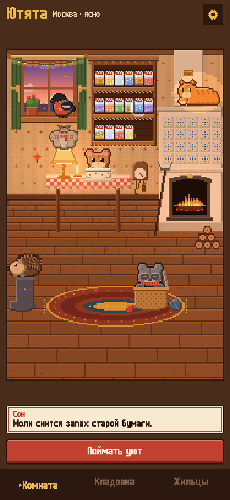
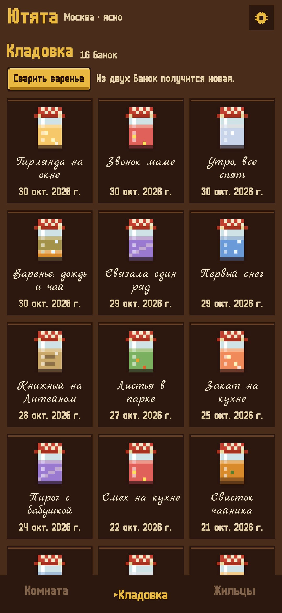
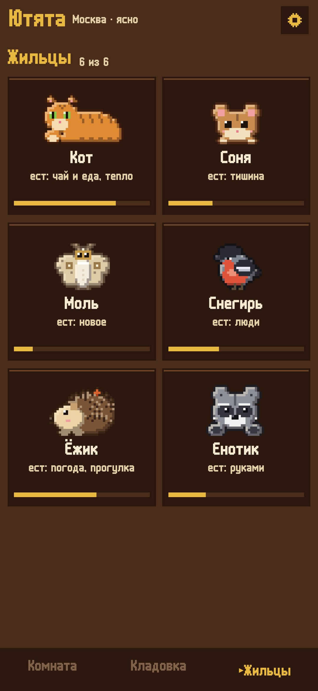

<div align="center">


# Ютята

### Лови уютные моменты дня в банки — а маленькие жильцы твоей комнаты будут ими питаться

*Дождь по зонту, свисток чайника, лампа вечером, тихая минута. Уют не нужно планировать по списку, его нужно замечать. Поймай момент телефоном, и он закатается в светящуюся банку на полке кладовки. В пиксельной комнате живут шестеро жильцов, и у каждого свой вкус. В трудный день открой банку и послушай. Бесплатно, без рекламы и аккаунта.*

[](https://github.com/bigdevwhale/nooklings/actions/workflows/android.yml)


[](LICENSE)

[English](README.md) · **Русский** · [Что нового](CHANGELOG.md)

   

**[Скачать APK](https://github.com/bigdevwhale/nooklings/releases/latest/download/Nooklings.apk)** · Android 9+

</div>

---

## Как это устроено

1. **Поймать.** Одна кнопка и четыре способа:
   - **звук** — десять секунд с микрофона;
   - **свет** — снимок обычной камерой телефона, его цвет наливается в банку;
   - **тишина** — три минуты, пока в комнате правда тихо; меряется только громкость, ничего не записывается;
   - **шаги** — шагомер; прогулки могут ловиться и сами.
2. **Назвать.** Одно касание: погода, прогулка, чай и еда, тепло, новое, люди, руками. У банки появляется подпись от руки, дата, город и погода, в которую её поймали.
3. **Жильцы едят.**
   - Кот — тепло и чай.
   - Соня — тишину.
   - Моль в очках — новое.
   - Снегирь — голоса.
   - Ёжик — погоду и прогулки.
   - Енотик — то, что сделано руками.

   Сначала в доме только кот и соня. Остальные стучат в окно, когда появляется первая банка их вкуса.
4. **Никто не умирает.** Голодный жилец бледнеет, спит в вязаном шарфе и просыпается от следующей банки. Сытые светятся. Если вечером все сыты, они сбиваются в кучу у печки.
5. **Сны.** Иногда жильцу снится загадка: «Моли снится запах старой бумаги». Принеси такой уют, и сон сбудется. За это жилец дарит подарок, который останется в комнате: коврик, свечку, открытку, рябину, кленовый лист или гирлянду.
6. **Открыть банку.** Звучит то, что в неё поймали. Банки без записи звучат своим вкусом: дождь, чайник, треск печки, страницы, голоса, спицы, шаги. Печь разгорается, и все собираются послушать.
7. **Варенье.** Из двух банок варится новая, она кормит обоих жильцов.

В окне настоящие время суток и погода твоего города (Open-Meteo, а если он недоступен — MET Norway). Снег, гроза и ночь дают редкие банки.

## Приватность

Всё хранится на телефоне: звуки и снимки лежат в папке приложения и никуда не уходят. В сеть ходят только запросы погоды и поиска города, в них нет ничего, кроме координат или названия.

## Сборка

```
./gradlew assembleDebug                      # отладочная сборка (app.nooklings.dev)
./gradlew assembleDebug -Pdemo               # полная кладовка, все жильцы дома
./gradlew testDebugUnitTest                  # логика дома, шагомер, звуки
./gradlew testDebugUnitTest -Prender --tests '*RenderScreens*' && python tools/shots.py   # скриншоты
python tools/res.py                          # строки на двух языках из одной таблицы
python tools/icon.py                         # иконка
```

Kotlin, Jetpack Compose, Room, DataStore, WorkManager. Весь арт рисуется кодом в маленькие пиксельные буферы.

## Благодарности

Шрифты: [m6x11](https://managore.itch.io/m6x11) Даниэля Линссена (кириллица Natto Games) и [Marck Script](https://fonts.google.com/specimen/Marck+Script) Дениса Машарова (SIL OFL). Часть [StillCraft](https://bigdevwhale.github.io/stillcraft/).
